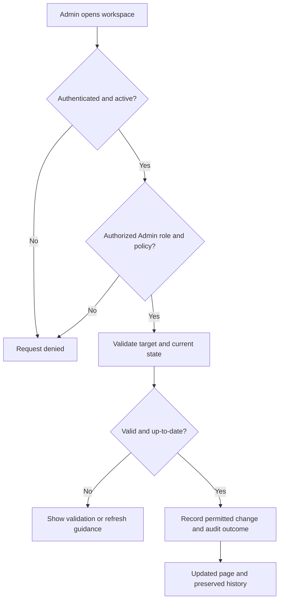

# TaskBridge administrator module — route and workflow map

**Purpose:** Give reviewers and new maintainers a compact map of the existing administrator workspace. This is a documentation-only review; it does not add application features or claim fresh test execution.

## Scope

The Administrator role is for platform oversight, not general access to private Client–Freelancer work. Its three management areas are accounts, project categories and dispute cases. Administrative actions retain relevant audit/decision records.

| Area | Entry route | Main purpose | Important boundary |
| --- | --- | --- | --- |
| Dashboard | `/admin/dashboard` | Entry point and administrative overview | Admin-only |
| Account list | `/admin/accounts` | Search/filter account records | Admin-only; no unrestricted private work access |
| Account detail | `/admin/accounts/{account}` | Review status/history and permitted status actions | Suspensions/reactivations apply to Client/Freelancer accounts only |
| Categories | `/admin/categories` | Create/edit categories and change availability | No category deletion; existing assignments are preserved |
| Dispute list | `/admin/disputes` | Review eligible dispute cases | Admin-only; only case-specific private context |
| Dispute detail | `/admin/disputes/{dispute}` | Review case and record allowed decisions | Admin cannot decide a case in which they were a participant or opener |

The routes above are declared in `routes/web.php`. An Admin is created by an authorized console bootstrap on a fresh installation, not from public registration.

## Four key administrative workflows

### A. Review an account

1. Log in with an **authorized, active Administrator** account.
2. Open **Accounts**, use search/filter, then open the correct Client/Freelancer record.
3. Check account status and previously recorded administrative actions before deciding whether any change is appropriate.
4. Do not infer access to that user's private project files from access to the account record.

### B. Suspend or reactivate a permitted account

1. Open the Client/Freelancer account detail page.
2. Review the confirmation and supply a meaningful **internal** reason.
3. Confirm only if the target and displayed state are correct.
4. The server rechecks account roles, freshness and current status. A completed status transition changes account access and records administrative history.
5. Earlier work records are preserved. Old authenticated sessions are revoked/invalidated. Reactivation requires a new login.

**Not available:** Changing roles, impersonating users, replacing their passwords or using administrative deletion from these controls.

### C. Manage a project category

1. Open **Categories**; create a category or edit its description if permitted.
2. Change Active/Inactive status through its separate confirmation.
3. Review shown affected counts and the latest state; stale confirmations require refresh.
4. An inactive category blocks *new* draft selection, publication, proposal submission and acceptance. Existing assigned work/history is not deleted.

**Not available:** Deleting a category or changing its existing slug.

### D. Review a dispute

1. Open **Admin → Disputes** and select a case.
2. Review the case-specific context and preserved statements; clarification may be requested when appropriate.
3. A permitted Admin may resolve or dismiss the case with a recorded rationale.
4. Closing a case removes that case's completion blocker; it does **not** refund/transmit money, rewrite project terms or complete the project automatically.

## Simple architecture of one admin action

The diagram is a **conceptual summary**, not a replacement for the implementation-level action code.

## Requirements and report trace

- **FR15 / US15** — Dispute Management
- **FR16 / US13** — User Administration
- **FR17 / US14** — Category Management
- **TC14, TC18, TC19** — Admin access, dispute and category test scenarios listed in the Group 14 report

## Authoritative references

- `routes/web.php` (actual route names and middleware)
- `docs/user-guide.md` → **Admin workspace**
- `docs/admin-accounts.md` (account status, audit and session rules)
- `docs/admin-categories.md` (category rules, confirmations and log)
- `docs/project-disputes.md` (case states and scoped access)
- Group 14 final report: functional requirements, administrator screenshots and test-case tables

**Review note:** Confirm the contents against the revision being demonstrated. Documentation may describe a newer repository revision than the last deployed release.
